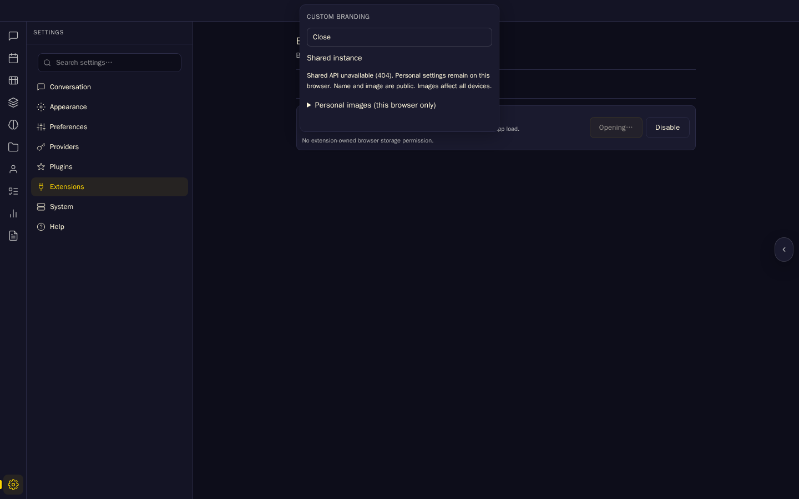
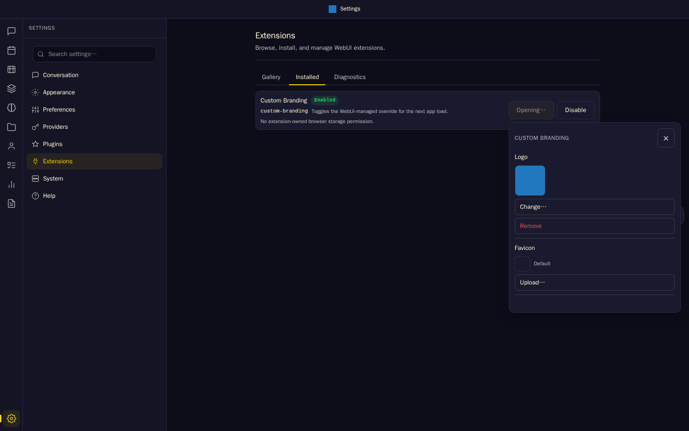
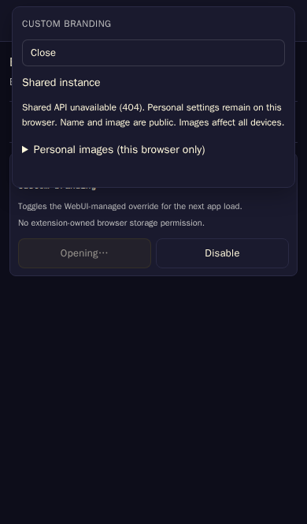
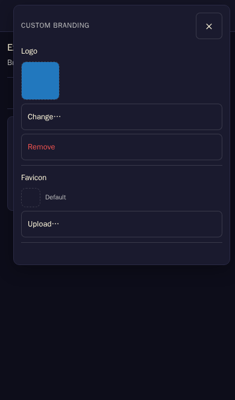
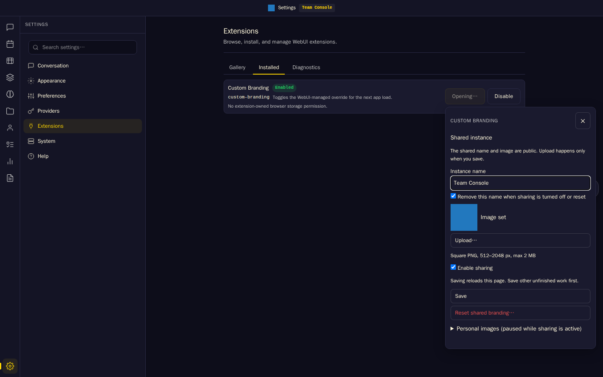
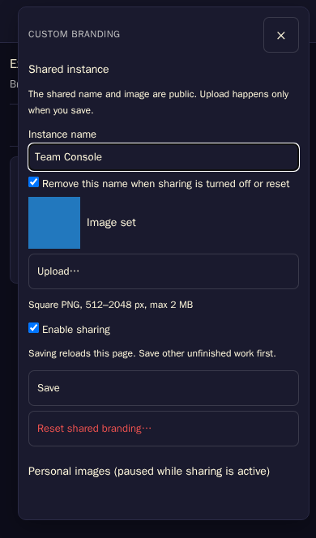
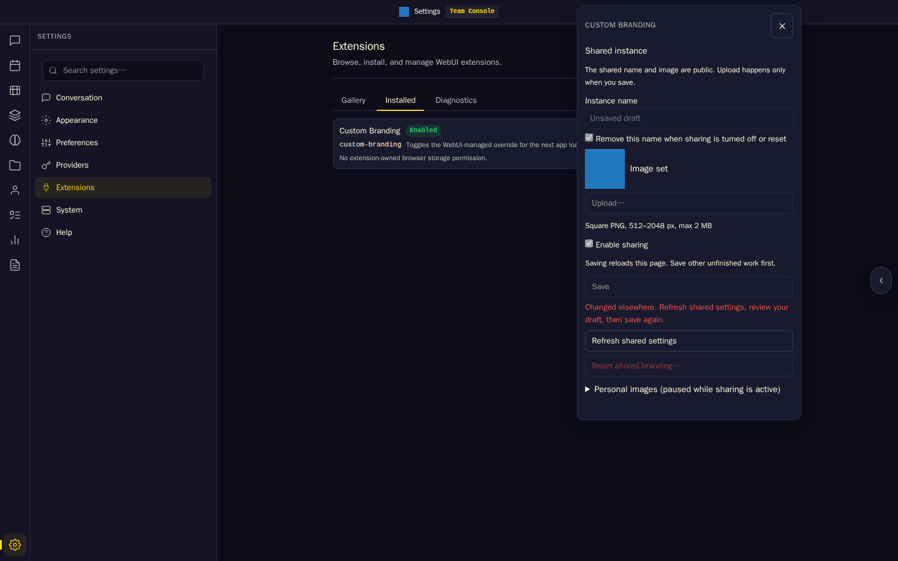
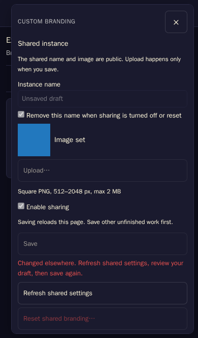
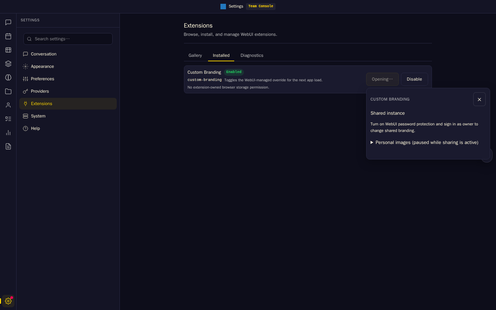
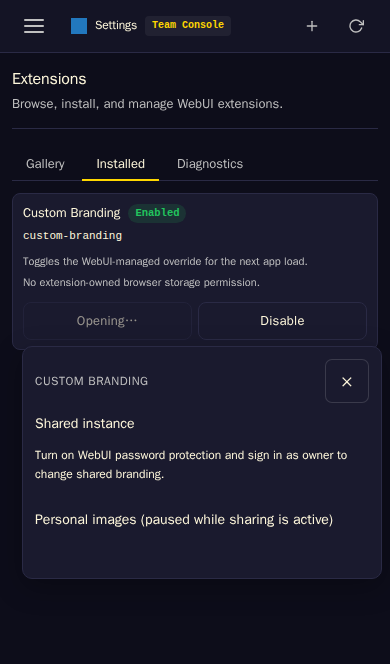

# Custom Branding review verification — 23 November 2026

The screenshots use the real **Settings → Extensions → Installed → Configure**
path. Before/after use English, the default dark skin, the same generated blue
512×512 PNG and the same viewports: **1440×900** and **390×664**. No real instance
assets, sessions or private configuration were used.

- Extension before: `edf0b5f0d64dfa9f292257b154b9f91f5858f751` (proposed 0.2.0).
- Extension after/runtime: `99d1ca888c25960ec105a2385141cd833047b216` (proposed 0.2.1).
- Core without v1: `72a93a2388dda2b6c91938784f09e5fb2dd9493c`.
- Proposed v1 core: `3fa1467f5548560d450cae404abecdd9f195e368` ([#8983](https://github.com/nesquena/hermes-webui/pull/8983)).
- Python 3.12.3, Pillow 13.0.0, Playwright 1.65.2,
  Chromium 159.0.8154.6 and Firefox 159.0.
- Final package SHA-256: `3122b9a2d6a279c5fac4c593e6962dcc7ae8078c3efb51e260850aff9969ee00`.

Fresh browser contexts; service workers blocked and HTTP cache disabled by
request routing. External network blocked. The native core installer verifies,
extracts and tracks the generated zip; its HTTPS download transport is replaced
with local zip bytes. This is not a gallery publication/download claim.

## Shipped core: before and after

Both images are seeded with the same personal logo. The after flow also uploads
that PNG through Configure and checks that its preview remains visible.
The picker is opened afresh at each width so before is not an offscreen resize.

| View | Before | After |
| --- | --- | --- |
| Desktop |  |  |
| Narrow |  |  |

No `api/instance-branding` request occurs on shipped-core page load. Opening
Configure performs the capability read, receives the actual 404, and shows only
Logo/Favicon without raw errors or a shared section. Personal upload and actual
Escape/focus restoration are exercised in both engines; Settings remains open.

## API v1: real server states

The manager imports PNG/name/activation with one Save and exact chained ETags.
A fresh context receives the shared shell/manifest without personal storage.
A separate real HTTP write then changes the ETag while the editor holds a draft:
Save receives **412**, retains the name and requires explicit refresh. Refresh
keeps the draft and never replays its mutation. Non-manager is a real auth-disabled
server with the same isolated persisted identity, not a mocked permission flag.

| State | Desktop | Narrow |
| --- | --- | --- |
| Manager, shared active |  |  |
| Actual 412 |  |  |
| Non-manager |  |  |

Equivalent Firefox captures are included as `review-firefox-*.png`.
[Machine-readable results](review-result.json) record both engines and checks.
Tests also cover 44px buttons, details toggle/reposition, provider toggles,
manifest id/scope/start_url/shortcut URLs, public asset MIME/nosniff, personal
priority, explicit disable and reset. The browser test code includes the final
capture improvements; runtime bytes are unchanged from the runtime commit above.

## Review changes and verification

| Review item | Result | Proof |
| --- | --- | --- |
| Dead shared section/personal controls | Shared section requires valid management; personal controls are direct when inactive; preview survives rebuild | Real shipped-core Configure in both engines; node absence/Retry cases |
| Navigation disclosure | One reload after complete Save; permission is true and the UI warns before Save | Native HTTP Save and `extension.json` |
| Bootstrap/GET/POST trust | Separate public and management validators; strict objects/flags/name/version; canonical app-root logo URL; keep last valid state | Malformed bootstrap, URL traversal, config/capability and POST behavior cases |
| Escape and Close | Capture Escape stops propagation, restores Configure focus and leaves Settings open; title-row cross; useful initial focus | Node event tests and real core handlers in both engines |
| Load probe/errors | No initial GET without bootstrap; absent API is silent; recoverable errors offer Retry | Real request inventory plus transport error test |
| Branding triggers | Empty mark removed only after successful Configure registration; no brand shortcuts for non-managers; legacy fallback retained | Real non-manager and successful/failed registration tests |
| One Save | Image staged locally, uploaded only on Save, chained canonical ETag, activation confirmation | Real PNG/name/enable flow; cancellation/partial-save behavior tests |
| Draft/412 | Typed state survives outside click/Escape/conflict; refresh explicit without replay or draft replacement | Real 412 plus behavior cases |
| Non-manager | Plain owner-auth sentence, no disabled form | Real auth-disabled server |
| Controls/copy/layout | Upload button/preview, destructive Reset, disabled styling, public/upload wording, 44px controls, resize/toggle positioning | Actual 390×664 captures and geometry checks |

**56 behavior cases**, all **25 extension suites**, 27 branch entries validated
and safety-scanned, registry/package generation, Markdown and diff checks pass.
Before the fix the same adversarial driver produces 50 failing cases and one
unhandled asynchronous rejection. Core has **492 targeted tests passing**;
its three rebase failures came from the save harness missing the newly used
native quota helper. The harness now evaluates the real helper and preserves
all canonical-name assertions.

The review requested in-place application when practical. This implementation
keeps **one reload after the complete Save**, because core owns the initial shell,
multiple title owners, PWA/Apple links and notification metadata and has no single
in-place identity application hook. Duplicating those owners in the extension
would widen this change. The permission and visible notice disclose the reload;
other unfinished page work can still be lost, so save it first. Image upload and
JSON patch are separate HTTP mutations, not an atomic transaction; partial or
unknown outcomes are reported without automatic retry. The unified button is
called Save because it covers name, image and activation together.

Shared mode still depends on a maintainer decision on the **unreleased** API in
core #8983. No merge, registry publication or production deployment is claimed.
Not tested: physical Android/iOS, installed-PWA launcher refresh, OS notifications,
real external proxy/OIDC, Windows, old workers/full HTTP caches or upgrade/rollback.
Earlier screenshots remain historical files from the initial proposal; the
`review-*` files above are the current comparable evidence.
