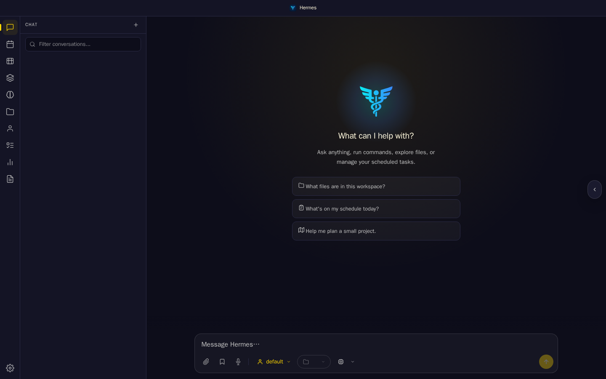
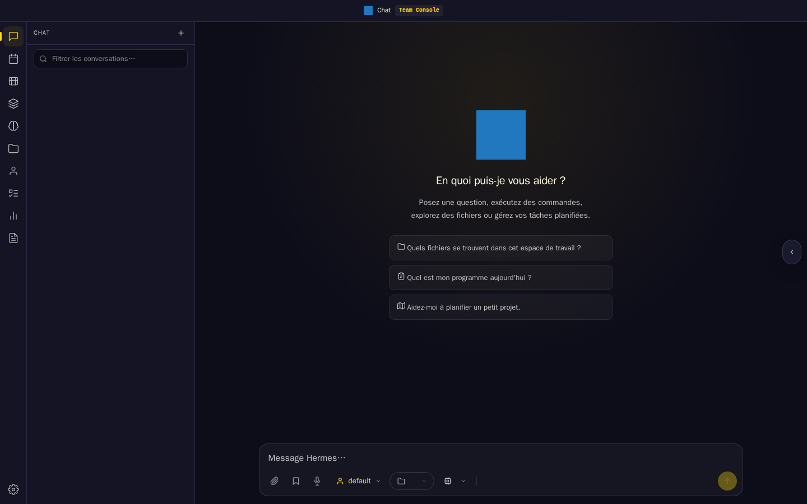
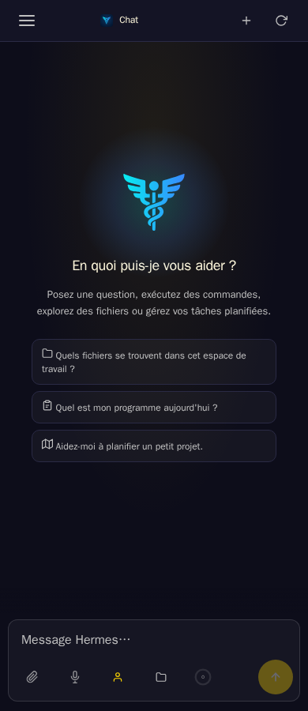
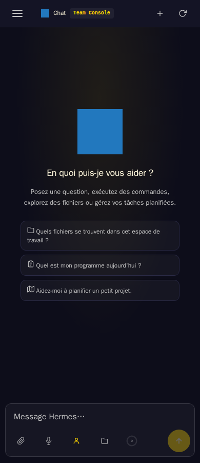
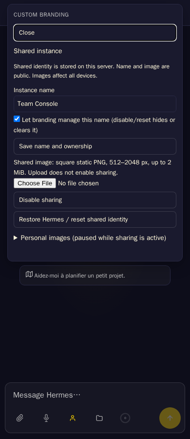

# Custom Branding API v1 browser evidence

These screenshots use a generated blue square and the generic name **Team
Console**. They contain no deployment data. They were captured on 7 November
2026 with the committed `tests/compatibility/custom_branding_smoke.py` against
core `036339c5f7085254f783c17fbf1bbfcbd9540da6`, using isolated state, native
test authentication and the real core package installer. The download
transport alone supplies locally generated ZIP bytes.

The extension runtime files are unchanged from
`5354b41c65c9aab5b9e9b43a8c8ec22a8d7252f1`; the package README now points to
the corrected core revision. Tested ZIP SHA256:
`8969767099f1dc8b35ebdc4b9e960b4d2787fb00b93bcfa077d0f8a5afcc56e0`.

Both headless engines passed: Chromium 156.0.8078.4 and Firefox 157.0,
Playwright 1.64.1, Python 3.13.16/Pillow 13.0.0. The screenshots below are
from Chromium at 1440 × 900 and 390 × 900. The initial desktop capture occurs
before automatic locale selection settles; later captures use the settled
locale. No locale code is changed by this contribution.

| View | Sharing inactive | Sharing active |
| --- | --- | --- |
| Desktop |  |  |
| Narrow |  |  |



The run exercised the packaged runtime handshake, installed loader, native
Configure, upload/name/enable, two clean browser engines, shared DOM logos,
initial metadata, manifest identity preservation, personal-image priority,
provider disable/reactivation, missing-v1 fallback, disable and reset.

```sh
node scripts/generate-registry.mjs --out dist/registry.json
python tests/compatibility/custom_branding_smoke.py \
  --core-dir /path/to/api-v1-core \
  --artifact dist/artifacts/custom-branding-0.2.0.zip \
  --evidence-dir /path/to/disposable-evidence
```

The committed smoke blocks service workers and external browser traffic;
routed traffic also disables the browser HTTP cache. This run does not prove
offline behavior or old-worker migration. It is desktop headless execution
and a narrow viewport, not a physical Android/iOS device or installed PWA.
Launcher refresh, OS notification display, external OIDC, Windows and
cross-version upgrades/rollback remain unverified. The server integration is
proposed on a fork; no upstream release availability is implied.
